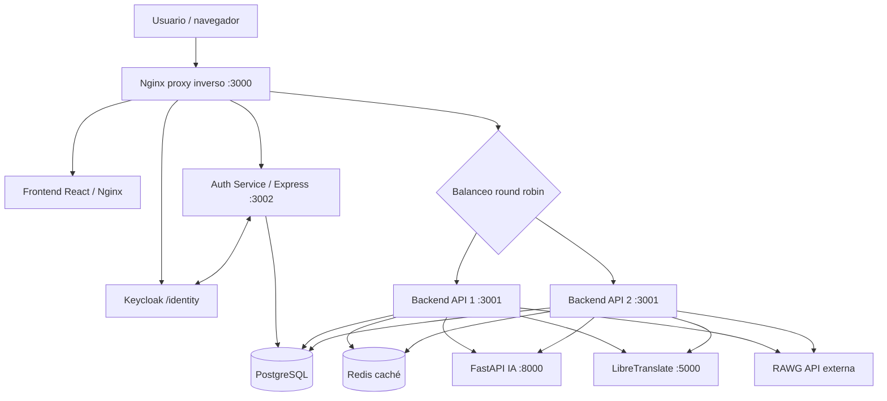

# GameTrack 🎮

**GameTrack** es una aplicación web para explorar videojuegos, administrar un catálogo, organizar una biblioteca personal y recibir recomendaciones según las preferencias del jugador. Se despliega mediante Docker Compose y utiliza una arquitectura basada en microservicios, un proxy inverso y una base de datos relacional.

## 1. Tecnologías

| Componente | Tecnología | Función |
|---|---|---|
| Frontend | React, Tailwind CSS, Nginx en contenedor | Interfaz web responsive |
| API de videojuegos | Node.js, Express, Sequelize | Catálogo, biblioteca, administración y orquestación de recomendaciones |
| Autenticación | Node.js, Express, JWT, bcrypt | Registro, inicio de sesión local, renovación, cierre de sesión y OIDC |
| Proveedor de identidad | Keycloak 26 | OAuth 2.0 / OpenID Connect y SSO |
| Recomendaciones | Python, FastAPI, scikit-learn | Recomendaciones basadas en contenido con TF-IDF y similitud coseno |
| Base de datos | PostgreSQL 16 | Persistencia de usuarios, juegos y biblioteca |
| Proxy inverso | Nginx 1.27 | Entrada HTTP, enrutamiento y balanceo round robin |
| Catálogo externo | RAWG API | Búsqueda y consulta de videojuegos externos |
| Caché compartida | Redis 7 | Caché de consultas y respuestas entre réplicas del backend |
| Traducción | LibreTranslate | Traducción de descripciones de juegos al español |
| Exportación | jsPDF y Canvas | Exportación de biblioteca a PDF y JPG con portadas |
| Contenedores | Docker Compose | Orquestación de servicios |

## 2. Arquitectura



**Recorrido de una solicitud:** el navegador se conecta a `localhost:3000`; Nginx envía `/` al frontend, `/api/auth/` a autenticación, `/identity/` a Keycloak y `/api/` a una de las dos réplicas del backend. El backend consulta PostgreSQL, RAWG o el microservicio de IA según la operación.

> Las réplicas `backend` y `backend2` ejecutan el **mismo microservicio de negocio**, no dos servicios de negocio diferentes. El balanceo se realiza en el `upstream game_api` de Nginx.

## 3. Funcionalidades por microservicio

### 3.1. `auth-service` — autenticación y usuarios

- Registro de cuentas locales con rol inicial `normal`.
- Inicio de sesión mediante correo y contraseña; contraseñas protegidas con bcrypt.
- Emisión y verificación de JWT de acceso y renovación de sesión.
- Renovación mediante cookie de sesión y cierre de sesión.
- Integración con Keycloak mediante OpenID Connect, incluyendo inicio de sesión y flujo de cierre de sesión OIDC.
- Validación de origen en operaciones sensibles de renovación y cierre de sesión.
- Limitación de solicitudes, CORS y cabeceras de seguridad con Helmet.

Rutas principales: `POST /api/auth/register`, `POST /api/auth/login`, `POST /api/auth/refresh`, `POST /api/auth/logout`, `GET /api/auth/me`, `GET /api/auth/oidc/login`, `GET /api/auth/oidc/callback`, `GET /api/auth/oidc/result` y `GET /api/auth/oidc/logout`.

### 3.2. `backend` y `backend2` — catálogo, biblioteca y administración

- Consulta y búsqueda del catálogo local.
- Búsqueda y detalle de videojuegos mediante RAWG, con caché Redis para acelerar consultas repetidas.
- Traducción de descripciones al español mediante LibreTranslate; la disponibilidad depende de los modelos de idiomas instalados (incluido japonés cuando se habilita).
- Consulta de desarrollador, distribuidor y capturas de pantalla disponibles en RAWG para la vista de detalles.
- Separación de los juegos creados manualmente por administración respecto de los títulos RAWG incorporados a bibliotecas personales.
- Servicio de descarga de portadas para exportaciones PDF/JPG sin problemas de CORS. Acepta imágenes directas HTTPS de RAWG, IGDB, Steam, Wikimedia, miniaturas de Google, CDNs de Facebook y otros proveedores conocidos de videojuegos. No admite enlaces a páginas HTML ni dominios arbitrarios; algunas imágenes de Facebook pueden caducar o impedir su descarga. Cuando una portada no puede incorporarse, se informa al usuario en la exportación.
- Importación de videojuegos al catálogo local.
- Creación, edición y eliminación de juegos para usuarios con rol `admin`, con **fecha de lanzamiento opcional** al crear juegos manuales y editable posteriormente.
- Biblioteca personal con estados `pendiente`, `jugando`, `completado` y `abandonado`, además de vista de favoritos. La presentación utiliza orden alfabético interno sin selector de ordenamiento.
- Registro de horas jugadas y favoritos.
- Preparación del historial del usuario y del catálogo candidato para solicitar recomendaciones al microservicio de IA.
- Validación de JWT y controles de autorización por rol.

Rutas principales: `GET /api/games`, `GET /api/games/global`, `GET /api/games/global/:rawgId`, `POST /api/games/import`, `POST /api/games`, `PUT /api/games/:id`, `DELETE /api/games/:id`, `GET /api/library`, `POST /api/library`, `PATCH /api/library/:id`, `DELETE /api/library/:id` y `GET /api/recommendations`.

### 3.3. `ai-service` — recomendaciones con Python

- Recibe el historial de juegos del usuario y un catálogo de candidatos.
- Representa géneros y plataformas mediante **TF-IDF**.
- Calcula similitud coseno para identificar videojuegos relacionados con las preferencias del usuario.
- Considera el estado y las horas jugadas al ponderar el historial.
- Excluye del conjunto de candidatos juegos ya presentes en el historial.
- Protege `POST /recommend` mediante la cabecera interna `X-API-Key`.

Rutas internas: `GET /health` y `POST /recommend`. Este servicio **no está expuesto directamente al host** en la configuración de Docker Compose.

## 4. Componentes de apoyo

- **Frontend:** interfaz React responsive para explorar juegos, iniciar sesión, consultar la biblioteca y recomendaciones, gestionar juegos como administrador y utilizar navegación móvil. Permite exportar la biblioteca a PDF y JPG con portadas. El modal de detalles tiene desplazamiento independiente y bloquea el scroll del fondo.
- **Nginx:** proxy inverso en el puerto público `3000`, con balanceo round robin entre `backend:3001` y `backend2:3001`.
- **Keycloak:** servidor de identidad con realm `gametrack`; la configuración inicial del realm se importa desde el directorio `keycloak/`.
- **PostgreSQL:** base de datos compartida por los servicios de autenticación y catálogo. Los datos persisten en el volumen `postgres_data`.
- **Redis:** caché compartida por las dos réplicas del backend, con persistencia en `redis_data`.
- **LibreTranslate:** servicio interno de traducción de descripciones; se comunica con el backend mediante la red Docker.

## 5. Modelo relacional

Los modelos Sequelize definen estas tablas en PostgreSQL:

| Tabla | Campos relevantes | Relaciones |
|---|---|---|
| `usuarios` | `id` (PK), `name`, `email` (único), `password_hash`, `role`, `created_at`, `updated_at` | 1:N con `recomendaciones` |
| `juegos` | `id` (PK), `title`, `description`, `platform`, `genre`, `release_date` (DATE), `cover_url`, `developer`, `publisher`, `screenshots` (JSONB), `external_id`, `created_at`, `updated_at` | 1:N con `recomendaciones` |
| `recomendaciones` | `id` (PK), `user_id` (FK), `game_id` (FK), `hours_played`, `status`, `favorite`, `score`, `created_at`, `updated_at` | N:1 con `usuarios` y N:1 con `juegos` |

La combinación (`user_id`, `game_id`) es única en `recomendaciones`. Las asociaciones están configuradas con eliminación en cascada. El modelo relacional editable se entrega como [`GameTrack-Modelo-Relacional.drawio`](GameTrack-Modelo-Relacional.drawio). El campo `release_date` admite NULL para registros antiguos y los importados desde RAWG; el formulario y la API permiten omitir la fecha al crear un juego manualmente; cuando se proporciona, debe ser una fecha real con formato `AAAA-MM-DD`. Los campos `developer` y `publisher` son opcionales; `screenshots` es JSONB no nulo con valor inicial `[]`. El script `database/upgrade-game-metadata.sql` documenta la actualización de metadatos en bases existentes. La actualización de la fecha se aplica de forma idempotente al iniciar el backend y también puede ejecutarse de forma manual con `database/upgrade-game-release-date.sql`.

> Este esquema corresponde a los modelos Sequelize del proyecto. Keycloak utiliza su propio almacenamiento interno, no representado en este modelo de negocio.

## 6. Requisitos

- Docker Desktop instalado y en ejecución.
- Docker Compose (`docker compose`).
- Acceso a Internet para descargar imágenes de Docker y consultar RAWG.
- Una clave de RAWG si se desea utilizar el catálogo externo.
- Puertos `3000` y `8080` disponibles en el equipo.

No es necesario instalar Node.js, Python ni PostgreSQL localmente para ejecutar el sistema con Docker.

## 7. Instalación en Windows PowerShell

Desde la raíz del proyecto:

```powershell
cd C:\GameTrack
Copy-Item .env.example .env
```

Editar `.env` y sustituir los valores de ejemplo por secretos propios. Variables principales:

| Variable | Propósito |
|---|---|
| `POSTGRES_DB`, `POSTGRES_USER`, `POSTGRES_PASSWORD` | Base de datos |
| `JWT_ACCESS_SECRET`, `JWT_REFRESH_SECRET` | Firma de tokens; usar valores diferentes y de al menos 32 caracteres |
| `JWT_ACCESS_EXPIRES`, `JWT_REFRESH_EXPIRES` | Duración de tokens |
| `COOKIE_SECURE` | Usar `false` únicamente en desarrollo local HTTP; `true` con HTTPS |
| `CORS_ORIGIN` | Origen autorizado, por ejemplo `http://localhost:3000` |
| `RAWG_API_KEY` | Acceso al catálogo RAWG |
| `AI_SERVICE_API_KEY` | Clave compartida entre backend y servicio de IA |
| `KEYCLOAK_ADMIN`, `KEYCLOAK_ADMIN_PASSWORD` | Acceso administrativo a Keycloak |

Iniciar los servicios:

```powershell
docker compose up -d --build
docker compose ps
```

Accesos desde el equipo:

- **Aplicación:** http://localhost:3000
- **Salud del backend (mediante proxy):** http://localhost:3000/health
- **Consola de Keycloak:** http://localhost:3000/identity/admin/
- **Realm de Keycloak:** `gametrack`

**Importante:** el backend (`3001`), el servicio de autenticación (`3002`), FastAPI (`8000`) y PostgreSQL (`5432`) solo están expuestos dentro de la red Docker. No se accede a ellos mediante `localhost` desde el equipo sin publicar puertos adicionales.

## 8. Comandos de mantenimiento

```powershell
# Estado de los contenedores
docker compose ps

# Logs de los servicios principales
docker compose logs --tail=50 backend backend2 auth-service ai-service proxy keycloak redis translate

# Reconstruir frontend tras modificar React
docker compose up -d --build frontend

# Reiniciar Nginx si conserva direcciones internas antiguas tras reconstruir servicios
docker compose restart proxy

# Detener sin eliminar datos persistentes
docker compose down
```

No utilizar `docker compose down -v` si se desea conservar la base de datos y la configuración persistida de Keycloak.

### Actualizar una instalación existente con fecha de lanzamiento

1. Crear una rama para los cambios y copiar los archivos actualizados. **Conservar el `.env` original y los volúmenes**.
2. Ejecutar `docker compose up -d --build` desde la raíz del proyecto. El backend añade de manera idempotente la columna `release_date DATE` antes de sincronizar los modelos, sin borrar juegos anteriores.
3. Verificar con `docker compose ps` y abrir http://localhost:3000. Iniciar sesión como administrador y abrir **Administrar juegos**.
4. Crear un juego con **Fecha de lanzamiento** opcional y comprobar que se puede guardar tanto con una fecha como sin ella; al abrir sus detalles, se mostrará **Lanzamiento** cuando haya una fecha registrada. Los juegos antiguos que no tienen fecha mostrarán el dato como pendiente en administración hasta que se editen.
5. Si se desea aplicar previamente el SQL de forma manual, usar desde la raíz: `docker compose exec -T db psql -U gametrack_user -d gametrack < database/upgrade-game-release-date.sql` (ajustar usuario y base según `.env`). No hace falta ejecutar este paso si se inició el backend actualizado.

La columna nueva es **opcional en PostgreSQL** por compatibilidad con filas históricas y con importaciones RAWG; **opcional en el POST administrativo**. En PUT se permite actualizarla o dejarla vacía, y se rechazan fechas inválidas cuando se proporcionan.


### Pruebas automatizadas del backend

Las pruebas del backend utilizan `node --test` y simulaciones de dependencias externas. Para ejecutarlas con Node.js instalado:

```powershell
cd backend
npm install
npm test
```

Las pruebas automatizadas cubren rutas del catálogo y la biblioteca, utilizando simulaciones de las dependencias externas.

## 9. Verificaciones realizadas

Las siguientes pruebas fueron realizadas durante el desarrollo en el entorno local:

- Docker Compose con contenedores activos y PostgreSQL saludable.
- Registro, autenticación local y flujo OIDC con Keycloak.
- CRUD administrativo y biblioteca personal.
- Catálogo RAWG y recomendaciones con respuestas exitosas del servicio Python.
- Balanceo round robin comprobado con 20 peticiones a `/health`, repartidas entre las dos réplicas.
- `GET /api/games` sin autenticación → **200 OK**.
- `POST /api/games` sin autenticación → **401 Unauthorized**.
- `POST`, `PUT` y `DELETE /api/games` con usuario normal autenticado → **403 Forbidden**.
- `POST /api/auth/refresh` y `POST /api/auth/logout` con origen externo no autorizado → **403 Forbidden**.
- Revisión visual de escritorio, tablet y móvil; se agregó navegación móvil tipo hamburguesa.

Las verificaciones corresponden al entorno local de desarrollo y no constituyen una auditoría integral de seguridad.

## 10. Seguridad

- El archivo `.env` contiene la configuración local y está excluido del repositorio; `.env.example` ofrece la plantilla de variables.
- Las cuentas locales utilizan hashes bcrypt y autenticación mediante JWT.
- Las operaciones administrativas cuentan con controles de autorización por rol.
- El servicio de IA utiliza una clave de acceso interna.
- Los servicios incorporan Helmet, validación de entradas, limitación de solicitudes y controles CORS/origen según corresponda.
- El despliegue documentado está orientado a desarrollo local mediante HTTP; los entornos públicos requieren configuración HTTPS.

## 11. Estructura del repositorio

```text
GameTrack/
├── ai-service/         # FastAPI y motor de recomendaciones
├── auth-service/       # Autenticación local, JWT y OIDC
├── backend/            # Catálogo, biblioteca y recomendaciones
├── frontend/           # Interfaz React y Tailwind
├── keycloak/           # Importación del realm
├── proxy/              # Configuración Nginx y balanceo
├── database/           # Scripts SQL para metadatos y fecha de lanzamiento
├── GameTrack-Modelo-Relacional.drawio  # Modelo relacional editable
├── docker-compose.yml  # Orquestación
├── .env.example        # Plantilla de configuración
└── README.md           # Documentación
```

## 12. Equipo de desarrollo

- **Hansel Fabricio Wong Gamboa** — 2790-23-14113
- **Luis Reynaldo De León Sopón** — 2790-22-581
